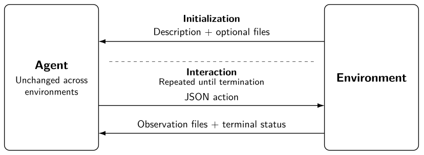

# EnvTraverse

EnvTraverse is an experimental framework for scientific studies of agents across
interactive environments. It separates the agent's problem-solving strategy from
the environment's task definition, so an environment-agnostic agent can be
evaluated across different tasks without changing its code or prompts.

For setup and examples, see [Running experiments](docs/running/README.md).

## Common interaction interface

Agents and environments share a simple interaction contract:

1. **Initialization:** the environment describes the task, its goal, and how to
   interact with it. It supplies an initial observation and may provide additional
   files, such as documentation or helper programs.
2. **Interaction:** the agent submits a JSON action. The environment returns
   observation files, which may contain text, images, or other data.
3. **Termination:** the environment indicates when the session ends. This does
   not necessarily mean that the task was solved.

Each environment defines its own actions, observation formats, and termination
rules. The agent decides how to solve the task. New agents and environments can
be integrated independently; the interaction contract does not require Codex or
even an LLM.

When comparing agents, keep the environment description, action semantics,
observation formats, and termination rules fixed. Changing these changes the
environment specification. The diagram and fuller discussion appear in
[paper03](../papers/paper03/README.md).

## Containers and experimental isolation

Each active task runs an agent and an environment server in separate Docker
containers, communicating over HTTP. The agent has its own workspace and no
direct access to the environment implementation or private results.

The supplied runners intentionally restrict the agent's direct internet access
to an allowlisted proxy for the model service. This helps prevent unintended
information channels, such as looking up task solutions outside the environment.
Environments can have their own internet access and may expose network operations
through their defined actions. This isolation policy is part of the experiment;
adapt an existing runner if a study requires different access.

## Environments

Interactive tasks can be integrated through an adapter that exposes JSON actions
and observation files. The shared server handles HTTP. Communication is initiated
by the agent, although the underlying environment may continue evolving between
requests.

| Environment | Package |
| --- | --- |
| Counter example, a starting point for new adapters | [example](src/server/environments/example/README.md) |
| ARC-AGI-3 | [arc3](src/server/environments/arc3/README.md) |
| AGI Maze: individual labyrinths | [agimaze_single](src/server/environments/agimaze_single/README.md) |
| AGI Maze: sequences of labyrinths | [agimaze_set_v1](src/server/environments/agimaze_set_v1/README.md) |
| Terminal-Bench | [terminal_bench](src/server/environments/terminal_bench/README.md) |

See [Adding environments](src/server/environments/README.md) for the adapter
interface and examples.

## Agents and HTTP

The [server README](src/server/README.md) documents the HTTP protocol. All bundled
agents provide their LLM with an environment-agnostic client that implements this
protocol and saves observations to files. The client is part of the agent; other
agents can use their own client or issue HTTP requests directly.

See [Agents](src/agents/README.md) for the bundled implementations and how to
integrate a new agent.

## Current runners

The supplied runners are oriented toward Codex:

- [run_controller.py](run_controller.py) uses Codex subscription accounts.
- [run_controller_with_api_key.py](run_controller_with_api_key.py) uses Codex with
  an OpenAI API key.
- [run_controller_tb.py](run_controller_tb.py) wraps the subscription runner with
  the additional host infrastructure required by Terminal-Bench.

Other providers or local models, including models needing GPU access, require
adapting a runner's authentication, networking, or container launch settings.
The agent–environment interaction contract can remain unchanged.

See [Running experiments](docs/running/README.md) for practical examples and
[Analysis](analysis_scripts/README.md) for processing the resulting runs.
